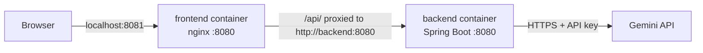

# Architecture

## Request flow (Docker Compose)

## Ports

| Where | Port | Notes |
|---|---|---|
| Your machine | 8081 | Published by `ports: "8081:8080"` on the frontend |
| frontend container | 8080 | nginx, non-root (cannot bind port 80) |
| backend container | 8080 | Spring Boot, reachable only inside the Docker network |

## Why it is built this way
- nginx serves the Angular files and forwards `/api/` to the backend, so the browser talks to one origin and CORS is not needed in Docker.
- `proxy_buffering off` in `nginx.conf` makes streamed replies arrive word by word.
- The backend is not published, so every request passes through nginx, where the rate limiter sees the real client IP (`X-Forwarded-For`).
- The API key lives in `.env` (git-ignored) and reaches the backend as an environment variable.
- Compose waits for the backend healthcheck (`/actuator/health`) before starting the frontend.

## Local development (no Docker)
Angular `localhost:4200` calls Spring Boot `localhost:8080` through `proxy.conf.json`.
